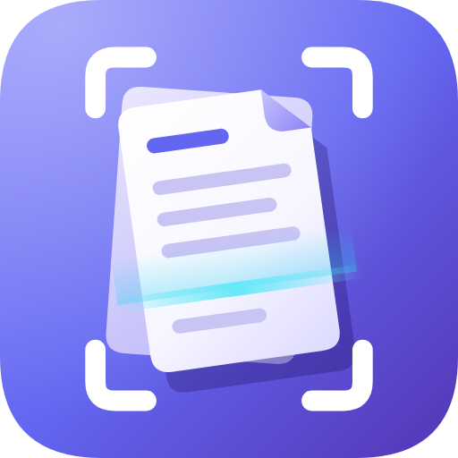

<p align="center">
  
</p>

# ScanMe

Aplikasi Android document scanner yang menghasilkan gambar setara hasil scanner flatbed: deteksi tepi real-time, koreksi perspektif, dewarping, penghapusan bayangan, dan filter warna, lalu export ke PDF/JPG. Seluruh pipeline ditulis ulang dengan library open-source berlisensi permisif (Apache 2.0 / MIT / BSD).

> **Status:** Fase 3 sedang berjalan. Pipeline klasik (termasuk dewarp) dan aplikasi lengkap (kamera, editor, daftar dokumen, export) sudah jalan dan diuji di HP (Galaxy A36). Sisa: dewarp ML (opsi B), deteksi live yang masih kadang > 50 ms/frame, dan keystore rilis untuk Google Play. Detail: [`docs/03-phase3-progress.md`](docs/03-phase3-progress.md).

## Fitur

| Fitur | Status |
|---|---|
| Deteksi tepi dokumen (Canny + region, refinement sisi, scoring, fusi) | ✅ |
| Stabilisasi sudut antar frame (One-Euro) + state machine auto-capture | ✅ |
| Koreksi perspektif dengan estimasi rasio aspek (Zhang–He) | ✅ |
| Normalisasi iluminasi / hapus bayangan (Lab, masker objek, push-pull fill) | ✅ |
| Filter Original, Auto Color, Grayscale, B&W (Sauvola) | ✅ |
| Dewarping halaman melengkung | ✅ klasik (baris teks) · ⏳ ML |
| Kamera live + overlay poligon + auto-capture + batch | ✅ |
| Editor: crop 4 sudut + loupe, rotasi, slider intensitas filter | ✅ |
| Daftar dokumen, rename, reorder, share, export PDF/JPG | ✅ |
| Halaman debug output tiap tahap pipeline (build debug saja) | ✅ |
| Layar About dengan daftar lisensi | ✅ |

## Tech stack

Kotlin 2.0, Jetpack Compose (Material 3), MVVM + Clean Architecture, Hilt, Coroutines/Flow, CameraX, OpenCV 4.14.0, Room, LiteRT (TFLite) untuk model opsional, `PdfDocument` untuk export.
minSdk 24, targetSdk/compileSdk 35. Versi lengkap ada di [`gradle/libs.versions.toml`](gradle/libs.versions.toml).

## Struktur modul

| Modul | Isi |
|---|---|
| `:app` | `Application`, Hilt root, navigasi, inisialisasi OpenCV, layar About |
| `:core:imaging` | **Kotlin/JVM murni**: seluruh pipeline image processing, bisa diuji tanpa device |
| `:core:camera` | Wrapper CameraX, konversi `ImageProxy` → `Mat` |
| `:core:ml` | Implementasi LiteRT untuk antarmuka model di `:core:imaging` |
| `:core:domain` | Model `Document`/`Page`, use case, interface repository |
| `:core:data` | Room, penyimpanan file halaman, export PDF/JPG |
| `:core:ui` | Tema dan komponen Compose bersama |
| `:feature:scanner` | Layar kamera, live overlay, auto-capture, batch |
| `:feature:editor` | Crop manual, rotasi, filter |
| `:feature:documents` | Daftar dokumen dan export |
| `:feature:debug` | Visualisasi tiap tahap pipeline untuk tuning parameter (debug only) |

Konfigurasi build bersama ada di convention plugins [`build-logic/`](build-logic).

## Build & test

Prasyarat: JDK 17, Android SDK (API 35). Buat `local.properties` berisi `sdk.dir=<path Android SDK>` jika Android Studio belum membuatnya.

```bash
./gradlew assembleDebug          # APK debug
./gradlew test                   # semua unit test
./gradlew :core:imaging:test     # test pipeline saja
```

Di Windows gunakan `gradlew.bat`. Setelah `:core:imaging:test`, contact sheet visual per kategori sampel tersimpan di `core/imaging/build/test-output/pipeline_*.png`.

Catatan:
- APK debug berukuran besar (~163 MB) karena OpenCV native untuk 4 ABI. Build release membatasi ke `arm64-v8a` dan `armeabi-v7a` (APK ~43 MB, AAB ~22 MB).
- Build release memakai keystore dari `keystore.properties` (tidak ikut git: `storeFile`, `storePassword`, `keyAlias`, `keyPassword`). Tanpa file itu build release ditandatangani kunci debug: bisa di-sideload, tapi ditolak Google Play.
- OpenCV 4.14.0: AAR Android-nya 16 KB page-aligned (syarat Google Play untuk target Android 15+). Test JVM memakai build desktop bytedeco dengan versi OpenCV yang sama (`org.bytedeco:opencv:4.14.0-1.5.14`); keduanya harus selalu dinaikkan bersamaan.

## Dokumentasi

1. [Arsitektur](docs/02-architecture.md): scope, stack, modul, desain pipeline
2. [Progres Fase 3](docs/03-phase3-progress.md): hasil test, temuan, keterbatasan, langkah berikutnya

Aturan kerja proyek untuk agent ada di [`AGENTS.md`](AGENTS.md).

## Lisensi pihak ketiga

Semua dependensi wajib berlisensi permisif. Daftar lengkapnya akan ditampilkan di layar About aplikasi. APK atau aset aplikasi referensi yang dipakai untuk analisis tidak boleh di-commit; `.gitignore` sudah memblokir file tersebut.
