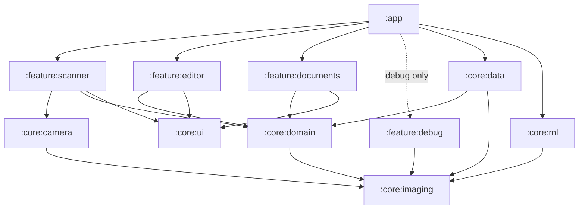

# Fase 2 — Arsitektur

> Dasar: AGENTS.md (Fase 2), temuan `01-technique-analysis.md`, dan keputusan K1–K3 (dokumen saja, tanpa OCR, runtime TFLite/LiteRT).
> Dokumen ini adalah rancangan. Kode belum ditulis; scaffolding dimulai setelah dokumen ini disetujui.

## 1. Scope produk

| Termasuk | Tidak termasuk |
|---|---|
| Deteksi tepi live + auto-capture, mode batch multi-halaman | Mode Whiteboard / Receipt / Form / Business Card / ID |
| Crop manual 4 sudut + loupe, rotasi | OCR, PDF yang bisa dicari |
| Koreksi perspektif, dewarping, shadow removal | Sinkronisasi cloud, akun |
| Filter: **Original, Auto Color, Grayscale, B&W** + slider intensitas | Smart eraser (bisa ditambah nanti) |
| Export PDF multi-halaman & JPG, share | |
| Daftar dokumen: rename, reorder halaman, hapus | |
| Halaman debug pipeline (khusus build debug) | |

---

## 2. Tech stack

| Area | Pilihan | Lisensi | Catatan |
|---|---|---|---|
| Bahasa | Kotlin (versi stabil terbaru), C++ hanya bila profiling membuktikan perlu | Apache 2.0 | — |
| UI | Jetpack Compose (BOM terbaru), Material 3, Navigation Compose | Apache 2.0 | — |
| DI | Hilt | Apache 2.0 | `:core:imaging` **tidak** bergantung Hilt (tetap murni). |
| Async | Coroutines + Flow | Apache 2.0 | — |
| Kamera | CameraX: Preview + ImageAnalysis + ImageCapture | Apache 2.0 | — |
| Image processing | **OpenCV 4.x** Android SDK (Maven `org.opencv:opencv`) | Apache 2.0 | AAR resmi **tidak** menyertakan opencv_contrib, sehingga Sauvola diimplementasikan sendiri (integral image, ±30 baris). |
| ML runtime | **LiteRT (TensorFlow Lite)** + GPU delegate, fallback CPU/XNNPACK | Apache 2.0 | Dipakai untuk model segmentasi (opsional) dan dewarp opsi B. |
| Database | Room | Apache 2.0 | — |
| Gambar di UI | Coil 3 | Apache 2.0 | Thumbnail, daftar dokumen. |
| PDF | `android.graphics.pdf.PdfDocument` | AOSP (Apache 2.0) | Cukup karena tanpa OCR (K2). |
| Daftar lisensi About | AboutLibraries (mikepenz) | Apache 2.0 | Dibuat otomatis dari dependensi Gradle. |
| Build | Gradle Kotlin DSL, version catalog, convention plugins (`build-logic`) | — | — |
| SDK | minSdk 24, targetSdk & compileSdk = API stabil terbaru saat setup | — | — |

---

## 3. Struktur modul



| Modul | Jenis | Isi | Dari AGENTS.md? |
|---|---|---|---|
| `:app` | Android app | `Application`, Hilt root, navigasi, layar About | Ya |
| `:core:camera` | Android lib | Wrapper CameraX, konversi `ImageProxy` (YUV) → `GrayFrame`, controller torch/fokus | Ya |
| `:core:imaging` | **Kotlin/JVM murni** | Seluruh pipeline: deteksi quad, fusi, smoothing, warp, dewarp klasik, iluminasi, filter, metrik kualitas. Antarmuka model ML (tanpa implementasi). | Ya |
| `:core:ml` | Android lib | Implementasi LiteRT untuk antarmuka model di `:core:imaging` | **Tambahan** (agar `:core:imaging` tetap teruji di JVM) |
| `:core:domain` | Kotlin/JVM | Entity, use case, interface repository | **Tambahan** (lapisan domain Clean Architecture) |
| `:core:data` | Android lib | Room, penyimpanan file halaman, export PDF/JPG | **Tambahan** |
| `:core:ui` | Android lib | Tema, komponen Compose bersama (loupe, overlay poligon, thumbnail filter) | **Tambahan** |
| `:feature:scanner` | Android lib | Layar kamera, live overlay, auto-capture, batch | Ya |
| `:feature:editor` | Android lib | Crop 4 sudut + loupe, rotasi, pilihan filter + slider | Ya |
| `:feature:documents` | Android lib | Daftar dokumen, rename, reorder, share, export | Ya |
| `:feature:debug` | Android lib, **debug saja** | Tampilan output tiap tahap pipeline berdampingan + slider parameter | Diminta di "Cara Kerja" |

Modul tambahan bisa digabung kembali kalau Anda lebih suka mengikuti daftar AGENTS.md persis. Yang terpenting adalah `:core:imaging` tetap murni JVM.

### 3.1 Cara `:core:imaging` tetap teruji tanpa Android

- `:core:imaging` memakai **API Java OpenCV** (`org.opencv.core.Mat` dan seterusnya) sebagai `compileOnly`.
- **Di aplikasi**, kelas dan native-nya disediakan oleh AAR `org.opencv:opencv`.
- **Di unit test JVM**, disediakan oleh artefak OpenCV desktop yang menyertakan native Windows/Linux/macOS (mis. `org.openpnp:opencv`, BSD/Apache).
- Kedua artefak **harus satu versi mayor.minor** OpenCV. Ini dicek di version catalog, dan ada test kecil yang membandingkan `Core.VERSION`.
- Risiko: artefak desktop bisa tertinggal versinya. Alternatif bila tidak cocok: test di `:core:imaging` dijalankan sebagai instrumented test di emulator. Lebih lambat, tapi tetap tanpa UI.

---

## 4. Lapisan Clean Architecture

```
presentation (feature:*)   Compose UI  ←  ViewModel (StateFlow<UiState>, events)
        │
domain (core:domain)       UseCase: DetectQuadLive, CapturePage, ProcessPage,
        │                  UpdateCrop, ApplyFilter, ReorderPages, ExportPdf, ExportJpg
        │                  Repository interfaces: DocumentRepository, PageImageStore
        │
data (core:data)           Room DAO, PageFileStore, PdfExporter, JpgExporter
imaging (core:imaging)     ScanPipeline + stages (pure functions)
```

Aturan:
- ViewModel hanya memanggil use case; tidak menyentuh `Mat` OpenCV.
- `Mat` tidak pernah keluar dari `:core:imaging` / `:core:data`. Lintas modul memakai `Bitmap` atau path file, plus tipe nilai (`Quad`, `FilterSettings`).
- Semua pemrosesan berat berjalan di dispatcher khusus (lihat §7).

---

## 5. Desain pipeline (`:core:imaging`)

### 5.1 Tipe utama

```kotlin
data class PointF(val x: Float, val y: Float)
data class Quad(val tl: PointF, val tr: PointF, val br: PointF, val bl: PointF)   // dinormalisasi 0..1

enum class QuadSource { CLASSIC_HIGH_CONTRAST, CLASSIC_LOW_CONTRAST, SEGMENTATION, MANUAL }
data class QuadCandidate(val quad: Quad, val source: QuadSource, val score: Float)

enum class FilterPreset { ORIGINAL, AUTO_COLOR, GRAYSCALE, BLACK_WHITE }
data class FilterSettings(val preset: FilterPreset, val intensity: Float = 1f)
data class DewarpMode(val enabled: Boolean, val engine: Engine) { enum class Engine { CLASSIC, ML } }

data class ProcessRequest(val quad: Quad, val rotationDeg: Int, val dewarp: DewarpMode, val filter: FilterSettings)
```

### 5.2 Tahap-tahap

| # | Tahap | Kelas | Input → Output | Resolusi |
|---|---|---|---|---|
| 1 | Deteksi kandidat quad | `ClassicQuadDetector` (2 profil: kontras tinggi/rendah), `SegmentationQuadDetector` (opsional, ML) | Gray ≤ 640 px → `List<QuadCandidate>` | ≤ 640 px |
| 2 | Fusi kandidat | `QuadScorer` | kandidat → kandidat terbaik + skor (luas, konveksitas, sudut ≈ 90°, kontras tepi, kecocokan mask) | — |
| 3 | Stabilisasi live | `QuadSmoother` (One-Euro filter per sudut) + `StabilityTracker` (gerak luma + variasi quad) | stream quad → quad halus + state `SEARCHING / UNSTABLE / STABLE(t)` | — |
| 4 | Perspektif | `PerspectiveCorrector` | full-res + quad → halaman rata; rasio dari panjang sisi, *snap* ke A4/Letter bila selisih < 3% | full |
| 5 | Dewarp | `ClassicDewarper` (text-line → model permukaan → remap), `MlDewarper` (antarmuka, implementasi di `:core:ml`) | halaman rata → halaman lurus | proses ≤ 1600 px, remap di full |
| 6 | Iluminasi | `IlluminationNormalizer` (estimasi latar: dilate → medianBlur → divide → normalize, di Lab/YCrCb) | → halaman dengan iluminasi rata | estimasi di ≤ 1024 px, apply di full |
| 7 | Filter | `FilterEngine` (Original / Auto Color / Grayscale / B&W) + blend intensitas | → hasil akhir | full |
| 8 | Metrik | `QualityMetrics` (L* latar, deviasi baseline, ketajaman) | dipakai test & halaman debug | — |

Pola dari Adobe yang diadopsi: **banyak kandidat + fusi** (tahap 1–2), dan **estimasi resolusi rendah, terapkan di resolusi penuh** (tahap 5–6).

### 5.3 Mode debug

`ScanPipeline.process(request, debug = true)` mengembalikan `PipelineResult` berisi gambar tiap tahap (edge map, kontur, kandidat, hasil warp, peta latar, hasil filter) beserta parameter yang dipakai. `:feature:debug` menampilkannya berdampingan dengan slider parameter.

---

## 6. Arsitektur kamera (`:core:camera` + `:feature:scanner`)

```
CameraX
 ├─ Preview ───────────────► PreviewView (Compose AndroidView)
 ├─ ImageAnalysis (YUV_420_888, KEEP_ONLY_LATEST, ~640×480)
 │     └─ Y plane → GrayFrame (tanpa konversi warna)
 │          → ClassicQuadDetector (+ Segmentation tiap N frame bila aktif)
 │          → QuadScorer → QuadSmoother → StabilityTracker
 │          → StateFlow<LiveDetection>  ──► overlay poligon + indikator "tahan stabil"
 └─ ImageCapture (resolusi maksimum, CAPTURE_MODE_MAXIMIZE_QUALITY)
        ▲  dipicu manual atau auto-capture (STABLE ≥ 800 ms, nilai awal, akan di-tuning)
```

- Hanya plane Y yang dipakai untuk deteksi live; konversi YUV→RGB dihindari di jalur live.
- Quad dari frame terakhir yang stabil dipakai sebagai **quad awal** untuk gambar full-res, dipetakan ulang ke koordinat foto. Lalu deteksi ulang sekali di resolusi lebih tinggi untuk akurasi.
- Toggle flash/torch, mode batch: setiap capture menambah halaman ke dokumen aktif tanpa keluar dari kamera.

---

## 7. Threading & performa

| Pekerjaan | Dispatcher / executor | Target |
|---|---|---|
| Analisis frame live | Executor single-thread milik ImageAnalysis | **< 50 ms/frame** di ≤ 640 px |
| Pipeline full-res per halaman | `Dispatchers.Default.limitedParallelism(2)` | **< 2 s/halaman** |
| Thumbnail preset filter | Pipeline yang sama di ≤ 512 px, di-cache per (halaman, preset) | < 300 ms untuk 4 thumbnail |
| I/O file & Room | `Dispatchers.IO` | — |
| Inferensi ML | Satu interpreter per model, GPU delegate jika tersedia, fallback XNNPACK | segmentasi < 30 ms; dewarp ML < 800 ms |

Lain-lain:
- `Mat` dipakai ulang (pool per tahap) agar tidak ada alokasi besar per frame.
- Hasil antara yang mahal (halaman terkoreksi sebelum filter) di-cache ke disk, sehingga ganti filter tidak mengulang warp/dewarp.
- Gating perangkat lemah: deteksi kelas perangkat (RAM, jumlah core, ketersediaan GPU delegate) lalu default ke dewarp klasik (sesuai AGENTS.md).

---

## 8. Data & penyimpanan

**Room**

```
DocumentEntity(id, title, createdAt, updatedAt, coverPageId)
PageEntity(id, documentId, orderIndex,
           originalPath, quadJson, rotationDeg,
           dewarpEnabled, dewarpEngine, filterPreset, filterIntensity,
           processedPath?, processedVersion, width, height)
```

**File** (`filesDir/documents/<docId>/`)
- `original/<pageId>.jpg`: foto asli, tidak pernah diubah (*non-destructive editing*).
- `corrected/<pageId>.png`: hasil warp + dewarp + iluminasi (cache, sebelum filter).
- `processed/<pageId>.jpg`: hasil akhir.
- `thumbs/<pageId>_<preset>.jpg`: thumbnail.
- Cache ditandai `processedVersion`; berubah jika quad/rotasi/dewarp berubah.

**Export**
- PDF: `PdfDocument`; ukuran halaman mengikuti rasio gambar (atau A4/Letter bila di-*snap*), gambar dikompres JPEG dengan kualitas yang bisa diatur (default 85).
- JPG: per halaman ke `MediaStore` (Pictures/ScanMe), atau ZIP untuk multi-halaman.
- Share lewat `FileProvider`.

---

## 9. Model ML (opsional, di belakang antarmuka)

| Model | Fungsi | Sumber | Status |
|---|---|---|---|
| Segmentasi dokumen | Upgrade deteksi tepi untuk background ramai/kontras rendah | DeepLabV3+/MobileNetV2 (TF Model Garden, Apache 2.0), **dilatih sendiri** | Setelah baseline klasik selesai. **Lisensi dataset wajib dicek.** |
| Dewarp | Opsi B | UVDoc / DocTr-style → TFLite INT8/FP16 | **Lisensi kode + bobot + dataset wajib diverifikasi** sebelum dipakai. Jika tidak lolos, hanya Opsi A (klasik). |

Pipeline harus berfungsi penuh **tanpa** model ML (baseline klasik). Model hanya meningkatkan kualitas.

---

## 10. Strategi pengujian

| Level | Lokasi | Isi |
|---|---|---|
| Unit (JVM) | `:core:imaging` | Tiap tahap diuji dengan sampel per kategori: **datar, buku melengkung, ada bayangan, kertas kusut, background ramai** |
| Golden/metrik | `:core:imaging` | Error sudut vs ground truth (≤ 2% diagonal), L* latar > 90 (Auto), deviasi baseline < 2% tinggi halaman (dewarp), teks tipis tetap ada (rasio piksel tinta) |
| Benchmark | `:benchmark` (Jetpack Microbenchmark), device mid-range | Waktu deteksi live dan pipeline penuh |
| UI | Compose UI test | Alur capture → crop → filter → export |

**Kebutuhan dari Anda:** foto sampel nyata untuk tiap kategori, dari kamera HP target. Idealnya 5–10 per kategori, ditambah anotasi 4 sudut (bisa saya bantu buatkan alat anotasinya). Tanpa sampel nyata, test awal akan memakai gambar sintetis.

---

## 11. Lisensi & layar About

- Semua dependensi di §2 berlisensi permisif (Apache 2.0 / MIT / BSD).
- AboutLibraries membuat daftar otomatis dari Gradle. Model ML (bila dipakai) dan datasetnya ditambahkan manual beserta lisensinya.
- Pemeriksaan di CI: build gagal jika ada dependensi baru dengan lisensi di luar allowlist.

---

## 12. Urutan kerja Fase 3 (usulan)

1. Scaffolding proyek: modul, version catalog, convention plugins, OpenCV (app + JVM test), Hilt, Room.
2. `:core:imaging` baseline klasik: deteksi quad + fusi + perspektif + iluminasi + 4 filter, dengan unit test dan metrik.
3. `:feature:debug` agar parameter bisa di-tuning secara visual.
4. Kamera live + auto-capture (`:core:camera`, `:feature:scanner`).
5. Editor, daftar dokumen, export.
6. Dewarp klasik (Opsi A); lalu ML (segmentasi, dewarp Opsi B) setelah lisensi terverifikasi.

## 13. Pertanyaan terbuka

1. Nama aplikasi & package (`applicationId`)? Sementara saya pakai `com.sauwork.scanme`.
2. Device mid-range acuan untuk benchmark (merek/tipe)?
3. Setuju dengan modul tambahan (`:core:domain`, `:core:data`, `:core:ml`, `:core:ui`, `:feature:debug`)?
